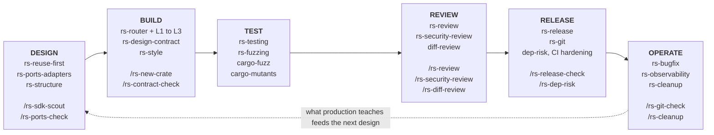
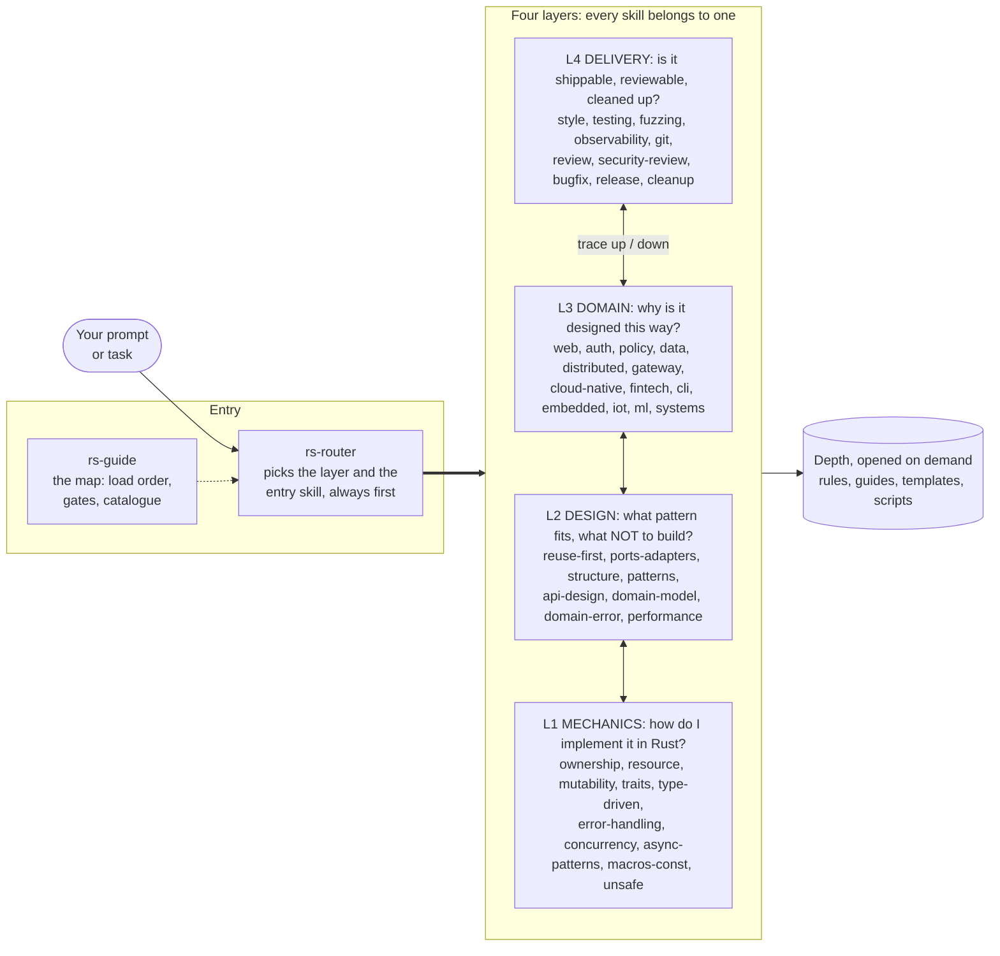
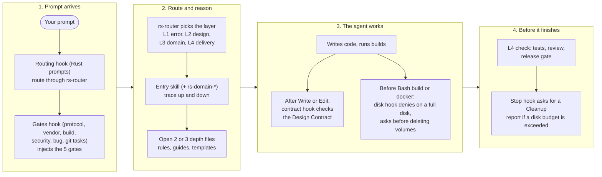

# rs-skills

[](https://github.com/bassem-elsodany/rs-skills/actions/workflows/ci.yml) [](LICENSE) [](https://github.com/bassem-elsodany/rs-skills/releases)

**Rust skills for coding agents — from the first `cargo new` to a release in production.**

62 skills, 400+ depth rules, 31 slash commands, helper scripts and hooks that make an agent *route before it answers*, *reuse the official SDK instead of drafting a protocol*, *decouple anything replaceable*, *review security with a threat model*, *clean up after its builds* and *leave a report a developer can follow*. Built for [Claude Code](https://claude.com/claude-code); the skills are plain Markdown, so other agents can use them too.


*Topics: rust, claude-code, agent-skills, ai-coding-agents, codex, cursor, code-review, security-review, fuzzing, ports-and-adapters, rust-best-practices.*



*Each phase lists its skills and the slash commands that start it. Findings from production feed the next design.*

> **New here?** Install it (next section), then read [`skills/rs-guide/SKILL.md`](skills/rs-guide/SKILL.md) — the navigation map: load order, lifecycle, the 13 gates, a catalogue of every skill, a glossary.

---

## Quick start (about two minutes)

**1. Install** — in Claude Code:

```
/plugin marketplace add bassem-elsodany/rs-skills
/plugin install rs-skills@rs-skills
```
(One step instead: `/plugin install rs-skills --marketplace bassem-elsodany/rs-skills`. Replace `bassem-elsodany/rs-skills` with the repository you cloned from. Claude Code ≥ 2.1.275 for the one-step form.)

**2. Reload and check** — run `/reload-plugins` (or start a new session), then `/plugin` → *Installed*: `rs-skills` should be listed and enabled. Type `/rs-` and the commands appear (full names look like `/rs-skills:rs-review`).

**3. Try it** in any Rust project — just ask:

```text
> Build an MCP server that exposes our policy checks as tools.        → reuse-first gate: finds the official SDK before any code
> Replace Redis with something else without touching business code.   → ports & adapters
> Review this branch for security problems.                           → threat model, sec-* classes, triage
> Why is my disk full?                                                → disk guard + tiered cleanup (dry run first)
```

**4. Scaffold or review something real:**

```text
/rs-skills:rs-new-crate my-svc --service     scaffold a production-ready crate (contracts, lints, CI, Dockerfile)
/rs-skills:rs-review                         write today's review report into <docs>/rs-reviews/YYYY-MM-DD/
/rs-skills:rs-release-check --strict         the pre-release gate
```

---

## Installation

### Requirements

| Needed | Check | Used for |
|---|---|---|
| Claude Code (recent; plugin support) | `claude --version` | the plugin: skills, agents, commands, hooks |
| `git` | `git --version` | installing from a repository, the git helpers |
| `bash` 3.2+ (the macOS default works) and `perl` | `bash --version` | all scripts and hooks |
| `python3` ≥ 3.9 | `python3 --version` | hooks, review and dependency scripts |
| `curl` | `curl --version` | `sdk-scout.sh`, `dep-risk.py` |
| Rust toolchain (`cargo`, `rustfmt`, `clippy`) | `cargo --version` | scripts that build, test and lint your crates |
| *Optional:* `docker`, `cargo-deny`, `cargo-audit`, `cargo-semver-checks`, `cargo-msrv`, `cargo-sweep`, `cargo-fuzz` (+ nightly), `cargo-mutants`, `cargo-llvm-cov`, `gitleaks`/`trufflehog`, `rg` | — | the gates and guides that mention them; a missing tool is a warning with an install hint, never a crash |

Tested on macOS (Apple silicon) with Claude Code. Linux is expected to work (scripts avoid GNU-only flags). Windows is untested — use WSL. `gh`/`glab` are never required.

### Claude Code

<details open>
<summary><b>From a hosted repository (recommended)</b></summary>

Inside a Claude Code session:

```
/plugin marketplace add bassem-elsodany/rs-skills
/plugin install rs-skills@rs-skills
/reload-plugins
```

or from your shell:

```bash
claude plugin marketplace add bassem-elsodany/rs-skills
claude plugin install rs-skills@rs-skills            # --scope user (default) | project | local
```

`bassem-elsodany/rs-skills` can also be a full git URL (`https://github.com/bassem-elsodany/rs-skills.git`, GitLab, Azure DevOps, a self-hosted host) or an SSH address.

**`Permission denied (publickey)`?** The marketplace is cloned with git. Either add an SSH key to your host, or use the HTTPS URL:

```
/plugin marketplace add https://github.com/bassem-elsodany/rs-skills.git
```
or tell git to rewrite SSH GitHub URLs to HTTPS once: `git config --global url."https://github.com/".insteadOf git@github.com:`.

</details>

<details>
<summary><b>From a local clone (also the way to try changes)</b></summary>

```bash
git clone https://github.com/bassem-elsodany/rs-skills.git ~/src/rs-skills

# A) install it (persistent)
claude plugin marketplace add ~/src/rs-skills
claude plugin install rs-skills@rs-skills

# B) or load it for ONE session only, nothing installed
claude --plugin-dir ~/src/rs-skills
```

After editing the clone, `/reload-plugins` picks up skill, command and hook changes in a running session. (`scripts/sync-local.sh` is for maintainers who keep the working copy as the source of truth: it refreshes every installed Claude profile.)

</details>

<details>
<summary><b>For a whole team (project scope)</b></summary>

```bash
claude plugin marketplace add bassem-elsodany/rs-skills --scope project
claude plugin install rs-skills@rs-skills --scope project
git add .claude/settings.json && git commit -m "chore: enable rs-skills for the team"
```
Settings are shared through git, but each teammate still adds the marketplace and runs the same install command once in their own clone (`claude plugin marketplace add bassem-elsodany/rs-skills` then `claude plugin install rs-skills@rs-skills --scope project`). Pin a release by adding `#<tag>` to the source (`bassem-elsodany/rs-skills#v1.6.1`).

</details>

<details>
<summary><b>Update, disable, uninstall</b></summary>

```bash
claude plugin marketplace update rs-skills          # refresh the catalogue
claude plugin update rs-skills@rs-skills            # new version loads next session or after /reload-plugins
claude plugin disable rs-skills                     # keep installed, switch off
claude plugin uninstall rs-skills@rs-skills
claude plugin marketplace remove rs-skills          # also forget the marketplace
```
Installed plugins are pinned to the `version` in `.claude-plugin/plugin.json`, so an update needs a new version (see the [changelog](CHANGELOG.md)).

</details>

<details>
<summary><b>Verify the installation</b></summary>

| Check | You should see |
|---|---|
| `claude plugin list` | `rs-skills@rs-skills` enabled |
| `/plugin` → *Installed* | `rs-skills` with no errors in the *Errors* tab |
| type `/rs-` | `/rs-skills:rs-review`, `/rs-skills:rs-new-crate`, … |
| ask a Rust question | the line `🦀 rs-skills loaded — routing through rs-router` (the routing hook) |
| work in a Rust project and say "build an MCP server" | the "before you build" gates are injected (reuse the SDK, decouple, clean up, …) |

Nothing needs configuring: the plugin has no required settings. Optional switches are under [Configuration](#configuration).

</details>

### Other agents (skills only — no hooks, agents or slash commands)

Codex, Cursor, Gemini CLI, GitHub Copilot, OpenCode, Windsurf/Devin and Kiro all discover skills as folders containing `SKILL.md` — most of them in a shared **`.agents/skills/`** location (Kiro: `.kiro/skills/`). The guidance carries over; Claude Code's hooks, slash commands and agents do not. One script handles the setup, including the bundle-level scripts a bare folder copy would lose:

```bash
git clone https://github.com/bassem-elsodany/rs-skills.git ~/src/rs-skills
cd /path/to/your/project
~/src/rs-skills/scripts/install-agents.sh --agents-md        # ./.agents/skills + a managed block in ./AGENTS.md
#   --scope user --agents-md ~/AGENTS.md   all your projects   ·   --kiro   also .kiro/skills
#   --mode copy   self-contained copy       ·   --dry-run  preview   ·   --uninstall  remove only what it created
```
Restart the agent so it rediscovers the skills. The managed `AGENTS.md` block tells the agent where the bundle root is, how to read `${CLAUDE_PLUGIN_ROOT}`, and the five "before you build" gates (the hooks cannot enforce them here).

**What was tested:** the installer itself (link and copy modes, project and user scope, dry run, repeat runs, refusal to overwrite foreign folders, uninstall) on macOS in throw-away directories. **What was not:** the agents themselves — the per-tool locations and commands in [docs/other-agents.md](docs/other-agents.md) come from each vendor's documentation and are marked as such there. The open `npx skills add bassem-elsodany/rs-skills` installer also works by the same shared location but copies skill folders only (you lose the bundle-level scripts) and was not run by the maintainer.

### Troubleshooting

| Symptom | Fix |
|---|---|
| `/rs-review` says unknown command | commands are namespaced: `/rs-skills:rs-review`; type `/rs-` and pick from the menu; run `/reload-plugins` after installing |
| Skills are installed for another agent but never trigger | confirm the agent reads `.agents/skills/` (or `.kiro/skills/`), restart it, and check the managed block exists in `AGENTS.md`; see [docs/other-agents.md](docs/other-agents.md) |
| Skills never seem to trigger | `/plugin` → *Errors* tab; make sure the plugin is enabled in this project's scope; ask a Rust question explicitly ("which skill handles E0382?") |
| A script path shows a literal `${CLAUDE_PLUGIN_ROOT}` | you installed skills without the plugin: read it as the bundle root (the managed `AGENTS.md` block from `install-agents.sh` says where it is) |
| A build was **denied** ("only N GiB free") | the disk hook did it: run `/rs-skills:rs-cleanup plan`, free space, retry; or `RS_DISK_GUARD=off` / lower `RS_MIN_FREE_GB` |
| The session won't finish ("disk budget exceeded") | the stop hook asks for a Cleanup report once: run `/rs-skills:rs-cleanup`, or raise `RS_TARGET_BUDGET_GB` / `RS_DOCKER_BUDGET_GB` |
| Hooks feel noisy | `RS_GATES=off` silences the "before you build" reminders; the routing hook only fires on Rust prompts |
| `python3: command not found` / `perl` missing | install them (Xcode CLT on macOS, `apt install python3 perl`) |
| Network scripts fail behind a proxy | `sdk-scout.sh` and `dep-risk.py` need crates.io/GitHub/api.osv.dev; use `dep-risk.py --offline` for the local census |
| Still stuck | `claude --debug` shows plugin and hook loading; then open an issue ([CONTRIBUTING.md](CONTRIBUTING.md)) |

---

## Using rs-skills

You mostly just work. The routing hook sends a Rust prompt through `rs-router`, which picks the layer and the right skills; the "before you build" gates fire when a task implements a standard, touches a replaceable dependency, builds, parses untrusted input or commits. Skills also load when your request matches their description. Commands are the explicit entry points:

| Command (prefix `rs-skills:`) | Does |
|---|---|
| `/rs-skills:rs-new-crate my-svc --service` | scaffold a production-ready crate: Design Contracts, lint policy, CI, `deny.toml`, Dockerfile + `.dockerignore`, slim dev profile |
| `/rs-skills:rs-sdk-scout <term>` | search crates.io + GitHub for the official/de-facto SDK before building a standard |
| `/rs-skills:rs-ports-check` | vendor code outside adapters? SQL in business code? |
| `/rs-skills:rs-review [path]` | report in `<docs>/rs-reviews/YYYY-MM-DD/`: TL;DR, cards with tick-boxes, work log |
| `/rs-skills:rs-diff-review --base main` | differential review of a branch/MR: risk, removed checks, blast radius, test gaps, reading order |
| `/rs-skills:rs-security-review` | threat-model-first security hunt with a triage verdict per finding |
| `/rs-skills:rs-dep-risk` | supply-chain report for Cargo dependencies (crates.io + OSV; `--offline` for the local census) |
| `/rs-skills:rs-release-check --strict` | fmt, clippy, tests (MSRV + stable), docs, contracts, structure, ports, git hygiene, dependency census, deny, semver, disk |
| `/rs-skills:rs-git-check` | repo hygiene for any Git host: secrets, tracked artefacts, message lint, attribution policy (`--public` for an open-sourcing checklist) |
| `/rs-skills:rs-cleanup [status\|plan\|apply]` | disk usage of `target/`, caches and Docker; tiered cleanup, dry run by default |
| `/rs-skills:rs-contract-check` · `rs-restructure` | every `.rs` has a valid Design Contract · restructure a flat crate in compiling steps |

### By phase: what to ask for

| Phase | You say… | Skills involved |
|---|---|---|
| **Design** | "implement an OAuth-protected MCP server" · "which crate for X?" · "where should this go?" | `rs-reuse-first`, `rs-ports-adapters`, `rs-structure`, `rs-domain-*`, `rs-patterns` |
| **Build** | "fix E0382" · "make this async-safe" · "add a macro" · "model this domain" | L1 mechanics via `rs-router`, `rs-error-handling`, `rs-async-patterns`, `rs-style`, `rs-design-contract` |
| **Test** | "fuzz the frame parser" · "are my tests good?" · "test this adapter" | `rs-testing`, `rs-fuzzing` (cargo-fuzz, cargo-mutants), contract suites |
| **Review** | "review this branch" · "is this exploitable?" · "audit the filter" | `rs-review`, `rs-security-review`, `rs-unsafe`, `rs-anti-pattern` |
| **Release** | "ready to ship?" · "are our dependencies/CI safe?" · "cut the release" | `rs-release`, `rs-git`, `rs-api-design`, `/rs-dep-risk` |
| **Operate** | "fix this panic" · "it used to work" · "why is my disk full?" | `rs-bugfix`, `rs-observability`, `rs-cleanup`, `rs-git` |

### What a session looks like (illustrative)

```text
you      > Build an MCP server that exposes our policy checks as tools.

agent    🦀 rs-skills loaded — routing through rs-router
         gate 1 (reuse first): protocol/standard detected → rs-reuse-first
           $ sdk-scout.sh "model context protocol" --github
           rmcp 3.x  OFFICIAL?  modelcontextprotocol/rust-sdk
         ### Reuse report
         - Chosen: rmcp (official) — features server, macros, transport-streamable-http-server
         - Hand-rolled JSON-RPC rejected: no constraint requires it
         gate 2 (decouple): policy engine and audit store are replaceable → rs-ports-adapters
           ports `Authorizer`, `AuditStore`; adapters in adapters/{memory,cedar,clickhouse}/
         gate 3 (clean up): disk-guard.sh status → 161 GiB free; images will be labelled
         …writes src/policy/{mod,model,ports,service}.rs, each with a Design Contract…
         /rs-review → docs/rs-reviews/2026-11-11/policy-server.md   (TL;DR, cards, work log)
         Cleanup report: target/ 0 → 1.8 GiB, scratch crate removed, 1 labelled image kept (needed)
```
*(Shortened and illustrative — the gates and commands are real; exact output depends on your agent and project.)*

---

## Why this exists

Coding agents are fluent in Rust and still repeat the same expensive mistakes:

| What goes wrong | What rs-skills does about it |
|---|---|
| Asked for a protocol server, the agent **drafts the protocol from memory** instead of using the official SDK, and you redo it | `rs-reuse-first`: a gate that searches crates.io + GitHub (`sdk-scout.sh`), a curated registry (MCP → `rmcp`, …), a required reuse report and decision record before any hand-rolling |
| Code talks straight to Postgres/Redis/ClickHouse/an SDK, so swapping a product is a rewrite | `rs-ports-adapters`: ports you own, adapters per product, contract suites, a composition root; `port-check.py` finds vendor leaks |
| "Split the long function" yields three functions in one flat `src/` | `rs-structure`: group-by-feature layouts, a size ladder, a visibility ladder, `structure-check.sh` |
| Every file is written from scratch; the next agent breaks the design | `rs-design-contract`: a ≤12-line `//! # Design Contract` header in every file, enforced by hooks |
| Reviews are one flat table nobody follows | `rs-review`: a folder per day, TL;DR, finding **cards** with tick-boxes, an agent **work log**, generated indexes, differential review |
| "Security review" means "I grepped for `unsafe`" | `rs-security-review`: threat model first, a capability probe, 16 `sec-*` bug classes, a triage protocol with severity per threat model |
| Builds and Docker images silently eat hundreds of GB | `rs-cleanup`: disk budgets, labelled artefacts, tiered dry-run cleanup, hooks that stop builds on a full disk and **ask before deleting volumes** |
| Bugs get a band-aid at the symptom | `rs-bugfix`: failing test first, fix at the invariant, hunt variants, prove with before/after/control |
| Messy history, secrets in commits, AI co-author trailers nobody asked for | `rs-git`: host-neutral commit/branch/release discipline, staged-secret scan, message lint, attribution policy |

## How it thinks




A **compile error** enters at L1 and traces *up* to the design and domain decision that caused it. A **design question** enters at L2, checks L3 constraints and traces *down* to L1. Every answer ends with an L4 check: is it testable, observable, releasable, cleaned up? Each skill is a short decision guide with *Trace ↑↓* tables; depth lives in `rules/`, `guides/` and `templates/` and is opened on demand.

## What's inside

| | |
|---|---|
| **62 skills** | 2 entry · 10 L1 · 12 L2 · 13 L3 · 11 L4 · 14 tools — generated catalogue in [`skills/rs-guide/SKILL.md`](skills/rs-guide/SKILL.md) |
| **402 rule files** | each: *Why it matters · Bad · Good · See also*; rule examples are compile-verified (`checks/`) |
| **50 pattern pages** | idioms, design patterns, anti-patterns and functional patterns (MPL-2.0 — see [NOTICE.md](NOTICE.md)) |
| **31 commands · 11 agents** | the slash commands above; research agents (crate/docs/clippy/changelog) and layer analysers |
| **Scripts** | `sdk-scout.sh`, `port-check.py`, `rust-caps.sh`, `diff-review.py`, `dep-risk.py`, `disk-guard.sh`, `cleanup.sh`, `git-check.sh`, `review-report.sh`, `release-check.sh`, `contract-check.sh`, `structure-check.sh`, … |
| **Templates** | CI (GitHub/GitLab, hardened), `deny.toml`, release profile, Dockerfile, `.dockerignore`, a ports-and-adapters crate, a fuzz harness, a policy-engine core, bug report, change summary, release checklist |
| **Hooks** | routing, "before you build" gates, Design Contract checks, disk guards |

### The gates

Non-negotiable; each has a skill, a script and (where it fits) a hook: router first · **reuse before build** · **decouple what can change** · structure before code · a Design Contract in every `.rs` file · fail closed · tests prove the Invariants · **security-review untrusted-input code, fuzz parsers** · **fix bugs test-first, then hunt variants** · a readable review report · the release gate is the definition of done · **clean up what you create** · version-control discipline. Details: [`skills/rs-guide/SKILL.md`](skills/rs-guide/SKILL.md).

### The Design Contract

Every `.rs` file an agent writes with rs-skills starts with a short module doc block that records what the file is for, so the next agent (or human) keeps the design:

```rust
//! # Design Contract
//! **Role:** Parses CLI configuration and validates it before anything else runs.
//! **Patterns:** Builder · Newtype ids (rs-type-driven)
//! **Invariants:** `Config` is immutable after `build()`; every path is absolute.
//! **Extend by:** add a field to `ConfigBuilder` with a default; do NOT add boolean flags.
//! **Avoid:** `Deref` for inheritance (rs-anti-pattern).
//! **Skills:** rs-patterns, rs-type-driven, rs-error-handling
```
A hook rejects an edited `.rs` file without one; `/rs-skills:rs-contract-check` audits a whole crate.

## Configuration

Nothing is required. Environment variables, if you want to tune behaviour:

| Variable | Default | Effect |
|---|---|---|
| `RS_GATES` | on | `off` silences the "before you build" reminders |
| `RS_DISK_GUARD` | on | `off` disables both disk hooks |
| `RS_MIN_FREE_GB` | 10 (hook) / 15 (scripts) | free space below which builds are denied / the session end is blocked |
| `RS_TARGET_BUDGET_GB` · `RS_DOCKER_BUDGET_GB` | 15 · 25 | disk budgets that trigger the stop-hook request for a Cleanup report |
| `RS_KEEP_DAYS` | 7 | age used by `cleanup.sh` tiers |
| `RS_GIT_ALLOW_AI_TRAILERS` | 0 | `1` (or an empty `.rs-git-allow-ai-trailers` file in the repo) lets commits carry AI attribution trailers |
| `RS_GIT_MAX_FILE_KB` | 5120 | size above which `git-check.sh` reports/blocks a file |
| `RS_REVIEW_DATE` | today | folder date for review reports |

## Hooks: what they do to your session

Hooks are the only part that can change what an agent is *allowed* to do. They are short shell scripts in [`.claude/hooks/`](.claude/hooks/), registered in [`hooks/hooks.json`](hooks/hooks.json). Read them before enabling.



| Hook | Event | Effect | Switch off / tune |
|---|---|---|---|
| routing | prompt submit (Rust prompts) | injects "route through rs-router, reason across layers" | — |
| gates | prompt submit (Rust project + protocol/vendor/build/git/security/bug prompts) | injects the five "before you build" gates | `RS_GATES=off` |
| contract | after Write/Edit/Bash touching `.rs` | rejects a changed file without a Design Contract | remove it from `hooks/hooks.json` |
| disk preflight | before Bash | **denies** `cargo build/test/…` and `docker build` when free space < `RS_MIN_FREE_GB`; **asks you** before `docker system prune --volumes`, `volume rm`, `compose down -v`, `prune -a` | `RS_DISK_GUARD=off` |
| disk stop | before the session ends | blocks finishing (once) while a disk budget is exceeded and asks for a Cleanup report | `RS_DISK_GUARD=off`, budgets above |

## Safety and privacy

- **Destructive actions are guarded.** `cleanup.sh` is a dry run unless you pass `apply`; its default tier removes only regenerable things, it never removes named volumes, and it removes labelled containers/images only in the labelled tiers. The hook asks before data-destroying Docker commands. History rewrites and force-pushes are "stop and confirm" in `rs-git`.
- **Network use is minimal and explicit.** `sdk-scout.sh` sends search terms to crates.io (and GitHub with `--github`); `dep-risk.py` sends public crate names and versions to crates.io and api.osv.dev (nothing with `--offline`); the research agents fetch public documentation. The scripts upload none of your source.
- **No attribution surprises.** Agents following `rs-git` add no AI co-author trailers unless you opt in.
- Report vulnerabilities privately: [SECURITY.md](SECURITY.md).

## Develop and verify

```bash
# in a clone
scripts/quality-check.sh && scripts/rules-check.sh && scripts/coverage-check.sh \
  && scripts/patterns-check.sh && python3 -I scripts/gen-guide.py --check \
  && python3 -I scripts/validate-plugin.py . && python3 tests/hook-matcher-test.py
claude plugin validate . --strict        # the official validator (needs the Claude Code CLI)
bash checks/check.sh                     # compile-verifies the rule examples on a pinned toolchain (needs cargo + network)
```
`scripts/validate-plugin.py --self-test` proves the offline validator's checks still fire. CI (`.github/workflows/ci.yml`) runs the same set. Project-level checks you can run on your own crates: `scripts/release-check.sh`, `contract-check.sh`, `structure-check.sh`, `port-check.py`.

```
skills/<name>/SKILL.md   the decision guide      rules/ guides/ patterns/ templates/ scripts/   depth, loaded on demand
agents/  commands/  hooks/  .claude/hooks/        Claude Code agents, slash commands, hook registry and scripts (agent helper docs: _meta/agent-support/)
scripts/                                          bundle and project checks (quality, rules, coverage, contracts, structure, release, …)
templates/                                        CI, deny.toml, Dockerfile, project layouts, error/concurrency/ffi snippets
index/  _meta/  docs/                             indexes, layer definitions, diagrams, other-agent install notes
checks/  tests/                                   compile-checks for rule examples; fixtures and behaviour tests
```
Contributing: [CONTRIBUTING.md](CONTRIBUTING.md) (authoring standards, what a good report contains). Changes: [CHANGELOG.md](CHANGELOG.md).

## Status and limits

- **Version 1.0.0**, single maintainer, opinionated by design.
- The heuristic scripts (`risk-scan.py`, `diff-review.py`, `port-check.py`, `rust-caps.sh`, `git-check.sh`) **nominate; they do not clear**. Reports state their coverage.
- Skills were refined on real projects (gateway policies, services, CLIs) rather than benchmarked. If a skill gives weak guidance, that is a bug.
- Verified: the bundle checks, `claude plugin validate --strict`, the scripts on scratch crates and real workspaces, and the compile-checked code in templates and rules. Not verified: hooks against every Claude Code version, other agents, Windows, and third-party crate APIs beyond the dates in the registry (`skills/rs-reuse-first/registry/standards.md` is dated — re-check with `sdk-scout.sh`).

## Licence

MIT — see [LICENSE](LICENSE). Third-party content and its licences are listed in [NOTICE.md](NOTICE.md).
